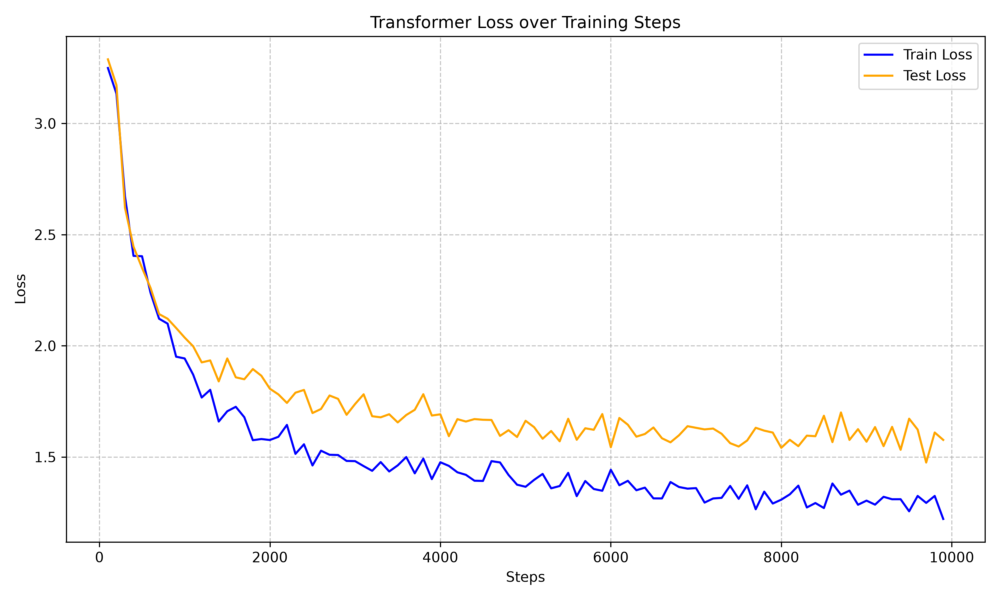

# MicroGPT

A **from-scratch, NumPy-only decoder-only Transformer** trained as a character-level language model on the Tiny Shakespeare dataset.  No PyTorch, no JAX — every forward pass, backward pass, and weight update is implemented by hand using pure NumPy array operations.

---

## Architecture

```
Token Embedding  (vocab_size × ed)
        ↓  + Sinusoidal Positional Encoding
[Layer Norm → Multi-Head Attention → Residual] × layers
        ↓
[Layer Norm → Feed-Forward Network  → Residual] × layers
        ↓
Final Layer Norm → Unembedding (ed → vocab_size) → Softmax
```

| Component           | Detail                                           |
|---------------------|--------------------------------------------------|
| Embedding           | Learned character embedding table               |
| Positional encoding | Fixed sinusoidal (Vaswani et al. 2017)          |
| Attention           | Multi-head causal self-attention with Pre-LN    |
| FFN activation      | GELU (tanh approximation, GPT-2 style)          |
| Optimiser           | Adam with linear warmup + inverse-time LR decay |
| Loss                | Cross-entropy (next character prediction)       |

### Default Hyperparameters

| Parameter     | Value | Description                              |
|---------------|-------|------------------------------------------|
| `ed`          | 128   | Embedding / d_model dimension            |
| `heads`       | 4     | Number of attention heads                |
| `qk_d`        | 32    | Query / Key projection dim per head      |
| `v_d`         | 32    | Value projection dim per head            |
| `layers`      | 4     | Number of stacked Transformer blocks     |
| `ffn_wd`      | 512   | FFN hidden width (4 × ed)                |
| `block_size`  | 8     | Context window / sequence length         |
| `batch_size`  | 1     | Examples per gradient step               |
| `base_alpha`  | 0.001 | Peak learning rate                       |
| `warmup_steps`| 500   | Steps for linear LR warmup               |
| `beta1`       | 0.9   | Adam first-moment decay                  |
| `beta2`       | 0.999 | Adam second-moment decay                 |

---

## Project Structure

```
microgpt/
├── model.py          – Transformer class (forward, backward, optimisers, save/load)
├── Tmodel.py         – Dataclasses for parameters, dimensions, and runtime caches
├── process_data.py   – Data loading, vocabulary, batch sampling, activations
├── train.py          – Training loop entry point
├── sample.py         – Text generation from a saved checkpoint
├── stats.py          – Loss curve plotting utility
├── input.txt         – Tiny Shakespeare corpus
├── loss_history.json – Loss log produced during training
└── loss_curve.png    – Saved loss curve plot
```

---

## Quickstart

### 1. Install dependencies

```bash
# Using uv (recommended)
uv sync

# Or plain pip
pip install numpy matplotlib
```

### 2. Get the dataset

```bash
wget https://raw.githubusercontent.com/karpathy/char-rnn/master/data/tinyshakespeare/input.txt
```

### 3. Train

```bash
python train.py
```

Training runs for **3 000 steps** by default with Adam.  Checkpoints are saved every 5 % of total steps and at the end.  Loss is logged every 1 % of steps to `shakespareADAM.json`.

### 4. Generate text

```bash
python sample.py
```

Loads the saved checkpoint and streams 2 000 characters to stdout (temperature = 0.8).  The full output is also written to `output.txt`.

### 5. Plot the loss curve

```bash
python stats.py
```

Reads `loss_history.json` and saves/displays the train vs. test loss plot as `loss_curve.png`.

---

## Training Progress

The chart below shows cross-entropy loss over **10 000 training steps** on the Tiny Shakespeare dataset.



**Key observations:**

- **Rapid initial descent** — loss drops sharply from ~3.3 to ~1.6 in the first 1 000 steps, reflecting the model quickly learning common character bigrams and word boundaries.
- **Sustained train-loss decline** — the training loss continues falling steadily, reaching ~1.2 by step 10 000.
- **Stable test loss** — the test (validation) loss converges to ~1.55–1.6 and remains flat after ~3 000 steps, indicating the model generalises well without obvious overfitting given the small architecture.
- **Train–test gap** — the ~0.35 gap is typical for a model of this size on a small corpus; it can be narrowed by regularisation (e.g. dropout) or a larger block size.

---

## Implementation Notes

### Why NumPy only?

This project is a learning exercise in understanding the internals of Transformers.  Implementing every operation explicitly — including the layer-norm backward pass, the softmax Jacobian, and the multi-head attention gradient — makes the mechanics transparent and debuggable without relying on autograd.

### Gradient flow

Backpropagation is performed in `Transformer.backward()` in `model.py`:

1. **Final step** — softmax + cross-entropy combined gradient, then unembedding weight gradient.
2. **Transformer blocks (reverse order)** — FFN backward (GELU → two linears → layer-norm) followed by attention backward (output projection → head un-merge → softmax → Q/K/V projections → layer-norm).
3. **Embedding table** — scatter-add the positional gradient back into the embedding rows that were used.

### Weight initialisation

| Weights           | Scheme                                |
|-------------------|---------------------------------------|
| Embedding `w_emb` | `N(0, 1/√ed)`                         |
| Q, K, V           | `N(0, 1/√ed)`                         |
| Output proj `Wp`  | `N(0, 1/√v_d)`                        |
| FFN `W0`          | `N(0, √(2/ed))`  (He initialisation)  |
| FFN `W1`          | `N(0, √(2/ffn_wd))`                   |
| Unembedding `Wu`  | `N(0, 1/√ed)`                         |
| Layer-norm γ      | Ones                                  |
| Layer-norm β      | Zeros                                 |

---

## License

MIT
